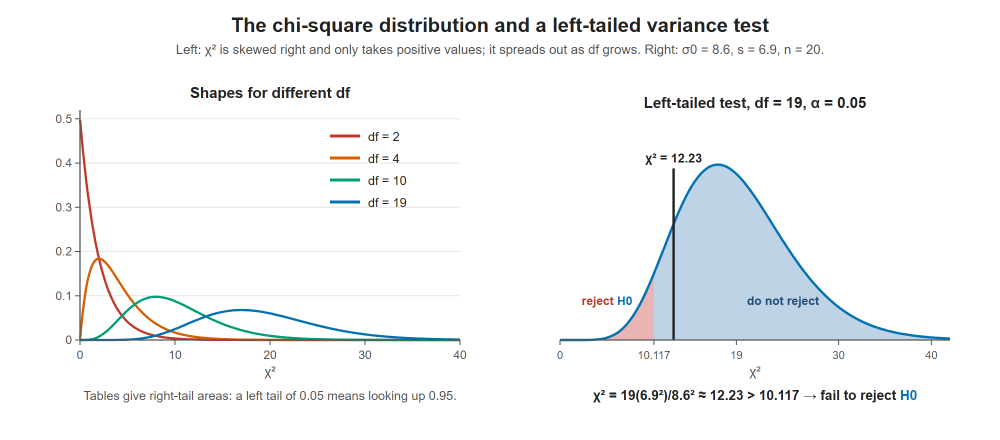

# Lesson 12.2 - The Chi Square Distribution Test of a Single Standard Deviation

> **Video:** [Chi Square Distribution Test of a Single Variance or Standard Deviation](https://www.youtube.com/watch?v=O6a76Dnn104) by The Organic Chemistry Tutor
> **Chapter:** [12 - The Chi-Square Distribution](https://www.video-tutor.net/chi-square-distributions.html)

## The big picture: testing spread instead of center

Every test so far has been about a **center**: a mean or a proportion. Sometimes the question is about **consistency**:

- Does a machine fill bags more evenly after a repair?
- Are this professor's exam scores less spread out than the department's?
- Is a new investment less risky (less variable)?

These questions make a claim about the population **standard deviation** $\sigma$ (or the variance $\sigma^2$), so we need a test for spread.

**1. Compare the sample's spread with the claim.** The natural measure is the ratio

$$\frac{s^2}{\sigma_0^2}$$

If ${\color{#0072B2}H_0}$ is true, this ratio should be close to 1. A ratio well below 1 suggests a smaller spread, and well above 1 a bigger one. In the example, $6.9^2 / 8.6^2 = 0.64$. Is that far enough below 1?

**2. Why multiply by $(n - 1)$?** The sample variance is $s^2 = \dfrac{\sum (x - \bar x)^2}{n - 1}$, so $(n - 1)s^2 = \sum (x - \bar x)^2$. Then:

$$\chi^2 = \frac{(n - 1)s^2}{\sigma_0^2} = \sum \left(\frac{x - \bar x}{\sigma_0}\right)^2$$

That is a **sum of squared z-scores**, just like in Lesson 12.1. It follows the χ² distribution, provided the population is roughly normal.

**3. Why df $= n - 1$?** The deviations $x - \bar x$ always add up to 0. Once you know $n - 1$ of them, the last one is forced. This is the same reason that df $= k - 1$ in Lesson 12.1. When ${\color{#0072B2}H_0}$ is true, χ² averages about df. Here that's 19, and we got 12.23: lower than usual, but is it low enough?

Even when $\sigma$ really is 8.6, samples of 20 give a range of $s$ values: about 90% fall between 6.3 and 10.8. To land in the lowest 5%, $s$ would have to be below 6.28 (that is, χ² below 10.117). Our $s = 6.9$ isn't low enough.

**4. The curve is not symmetric.** χ² can't be negative and is skewed right, so the left and right critical values are **not** mirror images like $\pm 1.96$. χ² tables list **right-tail** areas:

- **Right-tailed test:** look up $\alpha$.
- **Left-tailed test:** look up $1 - \alpha$ (here, 0.95).
- **Two-tailed test:** look up both $1 - \alpha/2$ and $\alpha/2$.

**5. Variance or standard deviation, it's the same test.** A claim about $\sigma$ is a claim about $\sigma^2$. Square the claimed SD: $\sigma_0 = 8.6$ becomes $\sigma_0^2 = 73.96$.

The 5 steps are the same as always. Only step 4 uses a new formula:

1. Write ${\color{#0072B2}H_0}$ ($\sigma^2 = \sigma_0^2$) and ${\color{#D55E00}H_a}$ ($<$, $>$ or $\ne$).
2. Choose $\alpha$.
3. Find the χ² critical value(s) with df $= n - 1$, using right-tail areas.
4. **Compute** $\chi^2 = (n - 1)s^2/\sigma_0^2$. ← this lesson
5. In the rejection region → reject ${\color{#0072B2}H_0}$. Otherwise → fail to reject ${\color{#0072B2}H_0}$.

---

## Test statistic

To test a claim about a population **variance** $\sigma^2$ (or standard deviation $\sigma$):

$$\chi^2 = \frac{(n - 1)\,s^2}{\sigma_0^2}, \qquad \text{df} = n - 1$$

- $s^2$ = sample variance
- $\sigma_0^2$ = the variance claimed in ${\color{#0072B2}H_0}$

| ${\color{#D55E00}H_a}$ | Test | Rejection region |
|---|---|---|
| $\sigma^2 < \sigma_0^2$ | Left-tailed | $\chi^2 <$ critical value, with area $\alpha$ on the left (look up right-tail area $1 - \alpha$) |
| $\sigma^2 > \sigma_0^2$ | Right-tailed | $\chi^2 >$ critical value, with right-tail area $\alpha$ |
| $\sigma^2 \ne \sigma_0^2$ | Two-tailed | both tails, $\alpha/2$ each |

---

## Example - is the spread of exam scores smaller?

The math department's exam scores have $\sigma = 8.6$. A professor thinks it is **less**. A sample of 20 scores has $s = 6.9$. Test at $\alpha = 0.05$.

**Known values:** $\sigma_0^2 = 8.6^2$, $\;s^2 = 6.9^2$, $\;n = 20$, $\;\text{df} = n - 1 = 19$

**Hypotheses:**
$${\color{#0072B2}H_0}: \sigma^2 = 8.6^2 \qquad {\color{#D55E00}H_a}: \sigma^2 < 8.6^2 \quad\text{(left-tailed)}$$

**Critical value:** the left-tail area is 0.05, so the right-tail area is 0.95. With df = 19 the table gives $\chi^2 = 10.117$. Reject ${\color{#0072B2}H_0}$ only if the calculated $\chi^2$ is **less than 10.117**.

**Test statistic:**
$$\chi^2 = \frac{(n - 1)\,s^2}{\sigma_0^2} = \frac{19 \times 6.9^2}{8.6^2} = \frac{19 \times 47.61}{73.96} \approx 12.23$$

$12.23 > 10.117$, which is in the do-not-reject region. **Fail to reject ${\color{#0072B2}H_0}$.** At the 5% level the sample does not provide enough evidence that the standard deviation is less than 8.6.

Left: χ² is never negative and is skewed to the right; with more degrees of freedom it moves right and spreads out. Right: for the left-tailed variance test the rejection region is the left tail below 10.117, and 12.23 does not reach it.

---

## Key takeaways

- Testing a variance or SD: $\chi^2 = (n - 1)s^2/\sigma_0^2$ with df $= n - 1$.
- If ${\color{#0072B2}H_0}$ is true, $s^2/\sigma_0^2 \approx 1$, so χ² is near df. A χ² far below df suggests less spread, and far above suggests more.
- χ² tables list **right-tail areas**. For a left-tailed test, look up $1 - \alpha$.
- Left-tailed: reject only when $\chi^2$ is **below** the critical value.
