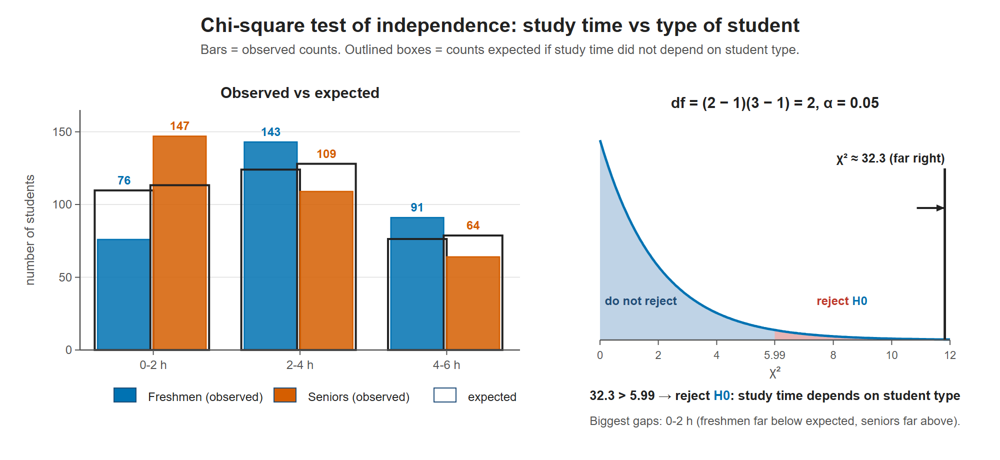

# Lesson 12.3 - Tests of Independence Using Chi-Square Distribution

> **Video:** [Test of Independence Using Chi-Square Distribution](https://www.youtube.com/watch?v=y5nxiL6civU) by The Organic Chemistry Tutor
> **Chapter:** [12 - The Chi-Square Distribution](https://www.video-tutor.net/chi-square-distributions.html)

## The big picture: are two categories related?

Lesson 12.1 compared **one** categorical variable with a distribution that $H_0$ stated in advance. Here there are **two** categorical variables measured on the same people, for example student type (freshman or senior) and daily study time (0-2, 2-4 or 4-6 hours). The question: **does knowing one tell you anything about the other?**

**1. Count the combinations in a table.** Each student falls into one row and one column. The result is a **contingency table** of counts, with row totals, column totals and a grand total.

**2. What would "no relationship" look like?** If study time had nothing to do with student type, freshmen and seniors would split across the study-time columns in the **same proportions**: the split of all 630 students. Overall, $223/630 = 35.4\%$ study 0-2 hours, so we'd expect 35.4% of the 310 freshmen to do so too:

$$E = 310 \times \frac{223}{630} = 109.7$$

**3. Where $E = \dfrac{\text{row total} \times \text{column total}}{\text{grand total}}$ comes from.** Use the multiplication rule for independent events (Lesson 5.5):

$$P(\text{row and column}) = P(\text{row}) \times P(\text{column}) = \frac{\text{row total}}{N} \times \frac{\text{column total}}{N}$$

To turn a probability into a count, multiply by $N$:

$$E = N \times \frac{\text{row total}}{N} \times \frac{\text{column total}}{N} = \frac{\text{row total} \times \text{column total}}{N}$$

So $H_0$ (independence) gives us every expected count, built from the table's own totals.

**4. Then it's the same χ² as Lesson 12.1.** Compare each observed count with its expected count, and add up $\frac{(O - E)^2}{E}$ over **every cell** of the table. A large χ² means the real table is far from the "independent" table.

Left: in the real data the freshman and senior rows look different. Middle: under independence both rows would have the same split. χ² measures the distance between these two pictures.

**5. Why df $= (r - 1)(c - 1)$.** The row and column totals are fixed. In each row, the last cell is forced by the row total, which leaves $c - 1$ free cells per row. The last row is forced by the column totals, which leaves $r - 1$ free rows. Here that is $(2 - 1)(3 - 1) = 2$ free cells.

**6. Related, not "causes".** Rejecting $H_0$ says the variables are **associated**. It doesn't say why. Seniors might study less for many reasons, and the test can't tell which.

**How this compares with Lesson 12.1:**

| | Goodness of fit (12.1) | Independence (this lesson) |
|---|---|---|
| Variables | one | two |
| Expected counts come from | the proportions that $H_0$ states | the table's own row and column totals |
| df | $k - 1$ | $(r - 1)(c - 1)$ |
| Test statistic | $\sum (O - E)^2/E$ | $\sum (O - E)^2/E$ over all cells |

---

## The idea

A **test of independence** checks whether two categorical variables in a **contingency table** are related.

| | Formula |
|---|---|
| $H_0$ | the variables are **independent** |
| $H_a$ | the variables are **dependent** (related) |
| Expected count for each cell | $E = \dfrac{\text{row total} \times \text{column total}}{\text{grand total}}$ |
| Test statistic | $\chi^2 = \sum \dfrac{(O - E)^2}{E}$ over **all** cells |
| Degrees of freedom | $(r - 1)(c - 1)$, where $r$ = rows and $c$ = columns |

It is a **right-tailed** test: reject $H_0$ if $\chi^2$ exceeds the critical value.

---

## Example - study time vs type of student

Is the number of hours spent studying each day related to whether a student is a freshman or a senior? $\alpha = 0.05$.

### Step 1 - complete the observed table

| | 0-2 h | 2-4 h | 4-6 h | **Row total** |
|---|---:|---:|---:|---:|
| Freshmen | 76 | 143 | 91 | **310** |
| Seniors | 147 | 109 | 64 | **320** |
| **Column total** | **223** | **252** | **155** | **630** |

### Step 2 - hypotheses and critical value

- $H_0$: study hours are **independent** of student type
- $H_a$: study hours **depend** on student type
- df $= (r - 1)(c - 1) = (2 - 1)(3 - 1) = 2$, right-tail area 0.05: $\chi^2_{\text{crit}} = 5.99$

### Step 3 - expected counts

$$E = \frac{\text{row total} \times \text{column total}}{\text{grand total}}$$

Example: $E_{1,1} = \dfrac{310 \times 223}{630} \approx 109.7$. The other cells use their own row and column totals, for example $E_{2,3} = \dfrac{320 \times 155}{630} \approx 78.7$.

| | 0-2 h | 2-4 h | 4-6 h |
|---|---:|---:|---:|
| Freshmen | 109.7 (≈110) | 124.0 | 76.3 (≈76) |
| Seniors | 113.3 (≈113) | 128.0 | 78.7 (≈79) |

The rounded values still match every row and column total (e.g. 110 + 124 + 76 = 310).

### Step 4 - test statistic (with the video's rounded expected counts)

$$\chi^2 = \sum_{\text{all cells}} \frac{(O - E)^2}{E}, \qquad \text{for example, the first cell: } \frac{(76 - 110)^2}{110} = \frac{1156}{110} = 10.51$$

| Cell | $O$ | $E$ | $(O - E)^2/E$ |
|---|---:|---:|---:|
| Freshmen, 0-2 | 76 | 110 | 10.51 |
| Freshmen, 2-4 | 143 | 124 | 2.91 |
| Freshmen, 4-6 | 91 | 76 | 2.96 |
| Seniors, 0-2 | 147 | 113 | 10.23 |
| Seniors, 2-4 | 109 | 128 | 2.82 |
| Seniors, 4-6 | 64 | 79 | 2.85 |
| **Total** | | | **≈ 32.3** |

> **Note:** expected counts don't have to be whole numbers. Using the unrounded values (109.73, 124.0, 76.27, 113.27, 128.0, 78.73) gives $\chi^2 \approx 31.7$. The conclusion is the same.

### Step 5 - decision

$32.3 > 5.99$, which is in the rejection region. **Reject $H_0$.** There is strong evidence that study time **depends** on student type. In the data, seniors are much more likely than freshmen to study only 0-2 hours a day.

Left: if study time were independent of student type, the bars would roughly fill the outlined expected boxes. The 0-2 hour group is far off for both freshmen and seniors. Right: χ² ≈ 32.3 is far beyond 5.99.

---

## Key takeaways

- Under independence every row has the same split as the whole table. That is where expected count = (row total × column total) ÷ grand total comes from.
- $\chi^2 = \sum (O - E)^2/E$ over every cell, with df $= (r-1)(c-1)$.
- Right-tailed: a large $\chi^2$ → reject independence → the variables are related.
