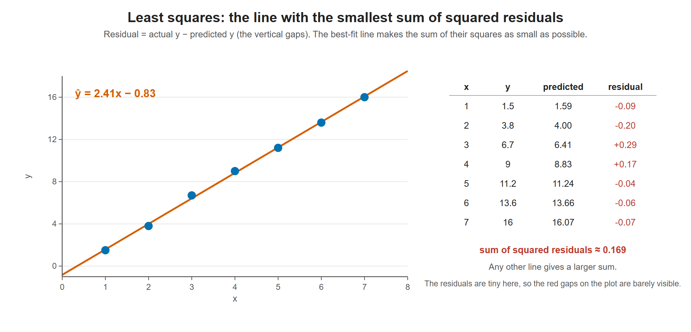

# Lesson 13.1 - The Least Squares Method

> **Video:** [Linear Regression Using Least Squares Method - Line of Best Fit Equation](https://www.youtube.com/watch?v=P8hT5nDai6A) by The Organic Chemistry Tutor
> **Chapter:** [13 - Regression & Correlation](https://www.video-tutor.net/linear-regression.html)

## Goal

Find the straight line that **best fits** a set of points that don't lie exactly on a line. The **least squares method** chooses the line that makes the points as close to it as possible: it minimizes the sum of the squared vertical distances.

## The line

| Algebra | Statistics | Meaning |
|---|---|---|
| $y = mx + b$ | $\hat y = b_0 + b_1x$ | |
| $m$ | $b_1$ | slope |
| $b$ | $b_0$ | y-intercept |

## Formulas

$$m = \frac{n\sum xy - \sum x\sum y}{n\sum x^2 - \left(\sum x\right)^2}, \qquad b = \frac{\sum y - m\sum x}{n}$$

$n$ = number of data points. Keep $m$ unrounded when you calculate $b$.

---

## Example

| $x$ | $y$ | $xy$ | $x^2$ |
|---:|---:|---:|---:|
| 1 | 1.5 | 1.5 | 1 |
| 2 | 3.8 | 7.6 | 4 |
| 3 | 6.7 | 20.1 | 9 |
| 4 | 9.0 | 36.0 | 16 |
| 5 | 11.2 | 56.0 | 25 |
| 6 | 13.6 | 81.6 | 36 |
| 7 | 16.0 | 112.0 | 49 |
| **Sum** | **61.8** | **314.8** | **140** |

$\sum x = 28$, $\;\sum y = 61.8$, $\;\sum xy = 314.8$, $\;\sum x^2 = 140$, $\;n = 7$

**Slope:**
$$m = \frac{7(314.8) - 28(61.8)}{7(140) - 28^2} = \frac{2203.6 - 1730.4}{980 - 784} = \frac{473.2}{196} \approx 2.414286$$

**Intercept:**
$$b = \frac{61.8 - 2.414286(28)}{7} = \frac{61.8 - 67.6}{7} = \frac{-5.8}{7} \approx -0.828571$$

**Line of best fit:**
$$\boxed{y \approx 2.41x - 0.83}$$

### Checking the fit

| $x$ | Predicted $y = 2.41x - 0.83$ | Actual $y$ |
|---:|---:|---:|
| 2 | 3.99 | 3.8 |
| 5 | 11.22 | 11.2 |
| 7 | 16.04 | 16.0 |

The predictions are very close to the data, so the line fits well.

The least squares line passes very close to every point. The residuals (actual minus predicted) are all small, and their squares add up to about 0.17, which is the smallest possible for any straight line.

---

## Doing it in Excel

With the $x$ values in `B2:B8` and the $y$ values in `C2:C8`:

| Want | Formula | Result |
|---|---|---|
| Slope $m$ | `=SLOPE(C2:C8, B2:B8)` (known **y**'s first, then known **x**'s) | 2.414 |
| Intercept $b$ | `=INTERCEPT(C2:C8, B2:B8)` | −0.8286 |

---

## Key takeaways

- Build a table with columns $x$, $y$, $xy$, $x^2$ and add up each column.
- $m = \dfrac{n\sum xy - \sum x\sum y}{n\sum x^2 - (\sum x)^2}$ and $b = \dfrac{\sum y - m\sum x}{n}$.
- Don't round $m$ before calculating $b$.
- Excel's `SLOPE` and `INTERCEPT` give the same results in seconds.
