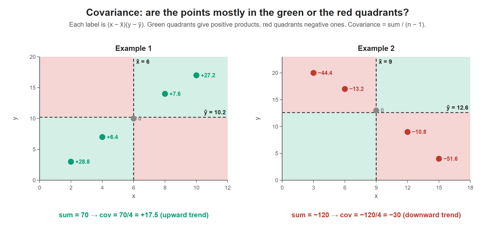

# Lesson 13.3 - How to Calculate the Covariance

> **Video:** [How To Calculate The Covariance Between X and Y](https://www.youtube.com/watch?v=rb2nU7YZV_I) by The Organic Chemistry Tutor
> **Chapter:** [13 - Regression & Correlation](https://www.video-tutor.net/linear-regression.html)

## Formula

$$\text{cov}(x, y) = \frac{\sum (x - \bar x)(y - \bar y)}{n - 1} \quad\text{(sample)}$$

For a **population**, divide by $N$ instead of $n - 1$.

## Steps (table method)

1. Columns: $x$, $y$, $x - \bar x$, $y - \bar y$, $(x - \bar x)(y - \bar y)$.
2. Find $\bar x$ and $\bar y$.
3. Fill in the deviation columns. Each one sums to 0, which is a useful check.
4. Multiply the deviations row by row and add the products.
5. Divide by $n - 1$.

---

## Example 1 - positive covariance

| $x$ | $y$ | $x - \bar x$ | $y - \bar y$ | product |
|---:|---:|---:|---:|---:|
| 2 | 3 | −4 | −7.2 | 28.8 |
| 4 | 7 | −2 | −3.2 | 6.4 |
| 6 | 10 | 0 | −0.2 | 0 |
| 8 | 14 | 2 | 3.8 | 7.6 |
| 10 | 17 | 4 | 6.8 | 27.2 |
| **Sum 30** | **Sum 51** | 0 | 0 | **70** |

$\bar x = 30/5 = 6$, $\;\bar y = 51/5 = 10.2$

$$\text{cov}(x, y) = \frac{70}{5 - 1} = 17.5$$

---

## Example 2 - negative covariance

| $x$ | $y$ | $x - \bar x$ | $y - \bar y$ | product |
|---:|---:|---:|---:|---:|
| 3 | 20 | −6 | 7.4 | −44.4 |
| 6 | 17 | −3 | 4.4 | −13.2 |
| 9 | 13 | 0 | 0.4 | 0 |
| 12 | 9 | 3 | −3.6 | −10.8 |
| 15 | 4 | 6 | −8.6 | −51.6 |
| **Sum 45** | **Sum 63** | 0 | 0 | **−120** |

$\bar x = 45/5 = 9$, $\;\bar y = 63/5 = 12.6$

$$\text{cov}(x, y) = \frac{-120}{5 - 1} = -30$$

(The video has a few slips while adding up this column, such as "−1.8" and "−20", but its final answer, −30, is correct.)

---

## What the sign means

On a scatter plot:

- Example 1: as $x$ increases, $y$ increases (an upward trend) → covariance **positive** (+17.5).
- Example 2: as $x$ increases, $y$ decreases (a downward trend) → covariance **negative** (−30).

| Covariance | Relationship |
|---|---|
| $> 0$ | Positive: the variables move **together** |
| $< 0$ | Negative: when one goes up, the other goes **down** |
| $\approx 0$ | No linear relationship |

> The **size** of the covariance depends on the units of $x$ and $y$, so it is hard to say whether 17.5 is "big". The **correlation coefficient** (Lesson 13.4) rescales it to the range −1 to +1.

Points up-right or down-left of the means (green) add positive products. Points up-left or down-right (red) add negative products. Example 1 is all green, so the covariance is positive. Example 2 is all red, so it is negative.

---

## Key takeaways

- Sample covariance $= \sum (x - \bar x)(y - \bar y)/(n - 1)$.
- The **sign** gives the direction of the relationship. The size is unit-dependent.
- The deviation columns always add to 0, which is a good check on your arithmetic.
